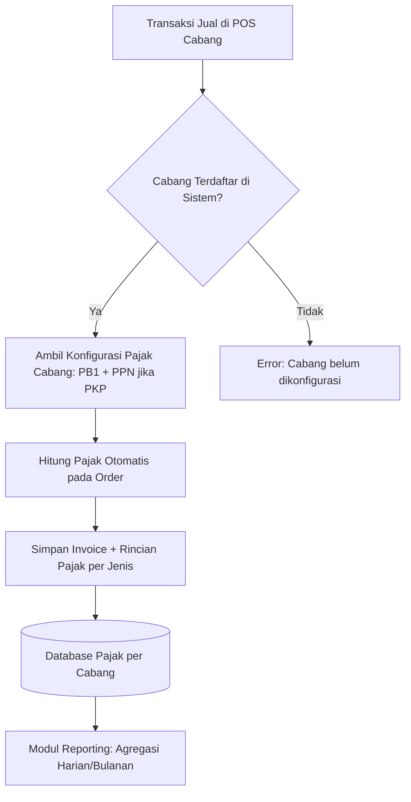
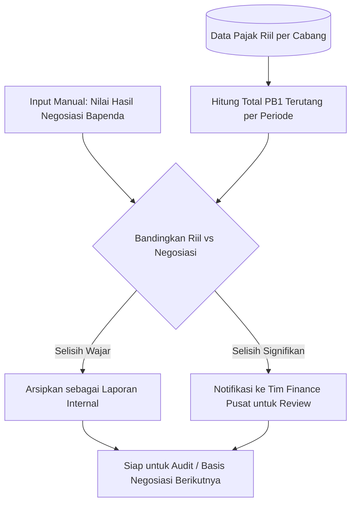
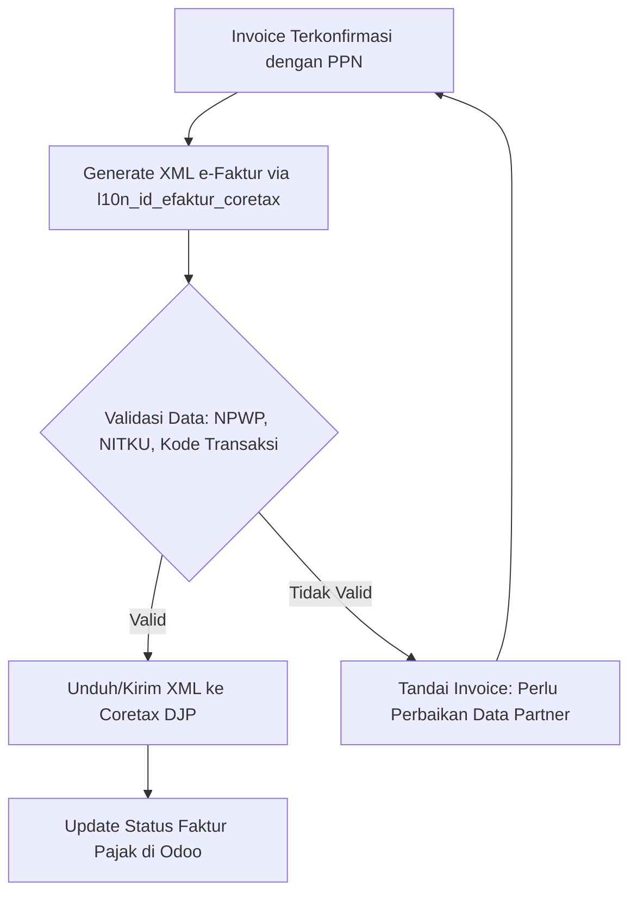
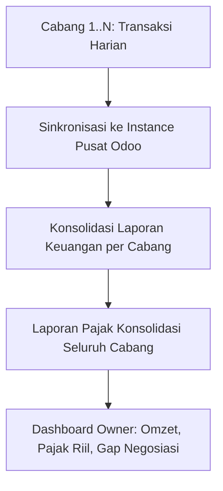

# PRD — Modul Pajak Terpadu untuk F&B Multi-Cabang (Odoo)

**Versi:** 1.0 **Tanggal:** 27 September 2026 **Status:** Draft untuk pembahasan

---

## 1. Latar Belakang

Bisnis F&B skala UMKM dengan 10+ cabang saat ini menjalankan kewajiban pajak daerah (PB1/Pajak Restoran) melalui jalur negosiasi informal dengan Bapenda di masing-masing wilayah. Model ini memiliki risiko:

- Bergantung pada relasi personal, bukan sistem — rentan berubah sewaktu-waktu.
- Tidak ada basis perhitungan pajak riil per transaksi/per cabang di sistem internal.
- ERP (Odoo) yang digunakan saat ini belum mengonfigurasi pajak jual (PPN/PB1) maupun pajak beli (PPN masukan) secara otomatis per transaksi.
- Potensi ketidaksiapan bila pemda mulai mendigitalisasi pajak daerah, atau bila kebijakan pajak pusat (Coretax/DJP) menuntut kerapian data faktur.

Modul ini dirancang untuk membenahi fondasi data pajak di Odoo terlebih dahulu, baru kemudian menyiapkan jalur integrasi resmi (Coretax DJP) dan pelaporan pajak daerah.

---

## 2. Tujuan Produk

1. Setiap transaksi jual (POS/invoice) dan beli (purchase) di semua cabang otomatis terhitung pajaknya (PB1 & PPN) sesuai konfigurasi masing-masing daerah.
2. Tersedia laporan pajak riil per cabang yang bisa dibandingkan dengan nilai yang selama ini dibayarkan via negosiasi.
3. Siap terhubung ke Coretax DJP untuk e-Faktur/PPN, apabila badan usaha berstatus PKP.
4. Data pajak terkonsolidasi lintas cabang dalam satu sistem yang auditable.

---

## 3. Target Pengguna

| Peran | Kebutuhan |
| --- | --- |
| Owner / Direktur | Melihat total kewajiban pajak riil vs. yang dibayar, lintas cabang |
| Tim Finance Pusat | Rekonsiliasi, laporan konsolidasi, ekspor data untuk Coretax |
| Kasir / Store Manager (per cabang) | Transaksi POS otomatis kena pajak yang benar tanpa input manual |
| Tim Pajak/Konsultan | Data siap audit, siap lapor resmi bila diperlukan |

---

## 4. Ruang Lingkup (Scope)

### Termasuk (In Scope)

- Konfigurasi pajak jual (PB1 per daerah, PPN bila PKP) per cabang
- Konfigurasi pajak beli (PPN masukan dari supplier)
- Laporan rekonsiliasi pajak per cabang (riil vs. negosiasi)
- Integrasi Coretax (pemanfaatan modul resmi `l10n_id_efaktur_coretax` + penyesuaian workflow)
- Konsolidasi data multi-cabang dalam satu instance Odoo

### Tidak Termasuk (Out of Scope — untuk fase ini)

- Pelaporan otomatis (API/H2H) langsung ke sistem Bapenda — karena mayoritas pemda belum punya sistem digital terbuka untuk ini
- Negosiasi/administrasi pajak daerah itu sendiri (tetap proses manual di luar sistem)
- Payroll/PPh 21 karyawan (dapat jadi modul terpisah di fase lanjutan)

---

## 5. Modul yang Diusulkan

| # | Modul | Fungsi Utama | Prioritas |
| --- | --- | --- | --- |
| 1 | `fnb_tax_engine` | Kalkulasi pajak jual & beli otomatis per cabang | Tinggi |
| 2 | `fnb_tax_reporting` | Dashboard & laporan rekonsiliasi pajak per cabang | Tinggi |
| 3 | `l10n_id_efaktur_coretax` + penyesuaian | Generate XML e-Faktur ke Coretax DJP | Menengah (jika PKP) |
| 4 | `fnb_branch_consolidation` | Konsolidasi laporan keuangan & pajak multi-cabang | Menengah |

---

## 6. Alur Sistem (System Flow)

### 6.1 Alur Transaksi Jual (POS) dan Perhitungan Pajak

### 6.2 Alur Rekonsiliasi Pajak Daerah (PB1)

### 6.3 Alur Integrasi Coretax (PPN/e-Faktur, bila PKP)

### 6.4 Alur Konsolidasi Multi-Cabang

---

## 7. Kebutuhan Data (Data Model — Ringkas)

| Model | Field Tambahan Kunci | Keterangan |
| --- | --- | --- |
| `res.company` / `branch` | `pb1_rate`, `daerah_perda_ref` | Tarif PB1 sesuai perda tiap daerah |
| `account.tax` | `branch_id`, `tax_type (PB1/PPN)` | Pajak spesifik per cabang |
| `account.move` (invoice) | `pb1_amount`, `ppn_amount`, `negotiated_amount` | Rincian pajak per transaksi |
| `res.partner` | `npwp`, `nitku`, `taxpayer_type` | Data wajib untuk Coretax |
| `fnb.tax.reconciliation` (baru) | `branch_id`, `period`, `real_tax`, `negotiated_tax`, `gap` | Model rekonsiliasi |

---

## 8. Metrik Keberhasilan

- 100% transaksi POS memiliki rincian pajak otomatis (tidak ada input manual pajak).
- Laporan rekonsiliasi per cabang tersedia maksimal H+1 setelah tutup periode.
- Waktu proses generate e-Faktur (bagi cabang PKP) berkurang dari manual ke otomatis.
- Data siap audit tanpa perlu rekonstruksi ulang dari nota fisik.

---

## 9. Tahapan Pengerjaan (Roadmap)

| Fase | Cakupan | Estimasi |
| --- | --- | --- |
| Fase 1 | `fnb_tax_engine` — konfigurasi pajak jual & beli per cabang | 2–3 minggu |
| Fase 2 | `fnb_tax_reporting` — dashboard rekonsiliasi | 2 minggu |
| Fase 3 | Integrasi Coretax (bila PKP) | 2–3 minggu |
| Fase 4 | `fnb_branch_consolidation` | 2 minggu |

*Estimasi bersifat indikatif, tergantung jumlah cabang aktif dan kompleksitas data existing.*

---

## 10. Risiko & Mitigasi

| Risiko | Mitigasi |
| --- | --- |
| Tarif PB1 beda tiap daerah & bisa berubah | Buat tabel konfigurasi tarif per daerah, bukan hardcode |
| Data partner (NPWP/NITKU) belum lengkap | Validasi wajib sebelum invoice bisa diproses ke Coretax |
| Resistensi cabang terhadap perubahan proses POS | Sosialisasi + training, rollout bertahap per cabang |
| Sistem pemda berubah sewaktu-waktu | Modul reporting dirancang sebagai laporan internal, bukan bergantung pada API pemda tertentu |

---

## 11. Catatan Terbuka (Perlu Konfirmasi Owner/Klien)

- Apakah badan usaha berstatus PKP? (menentukan prioritas Fase 3)
- Daftar lengkap 10+ cabang beserta kabupaten/kota masing-masing (untuk mapping tarif PB1)
- Apakah ada rencana standarisasi tarif PB1 di semua cabang, atau tetap ikut ketentuan tiap daerah?